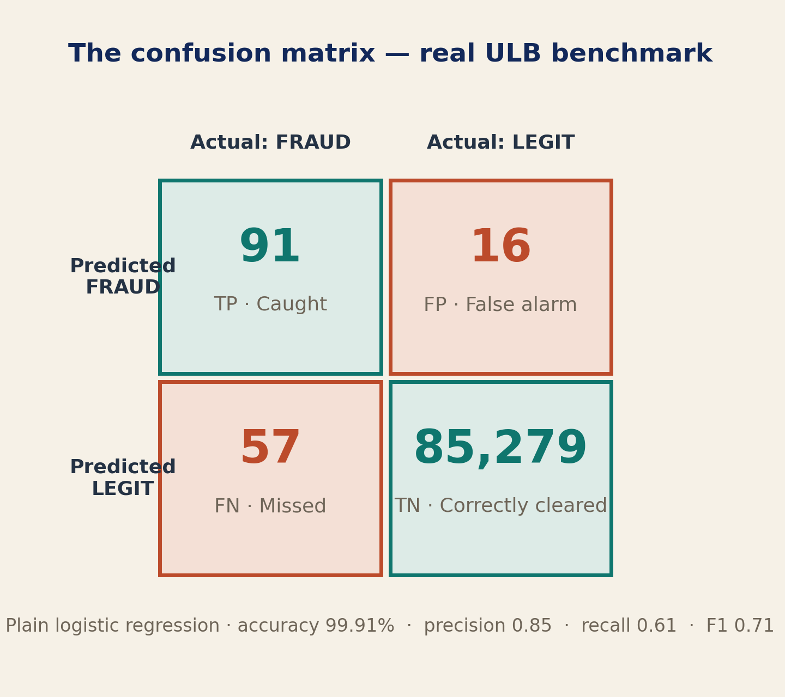
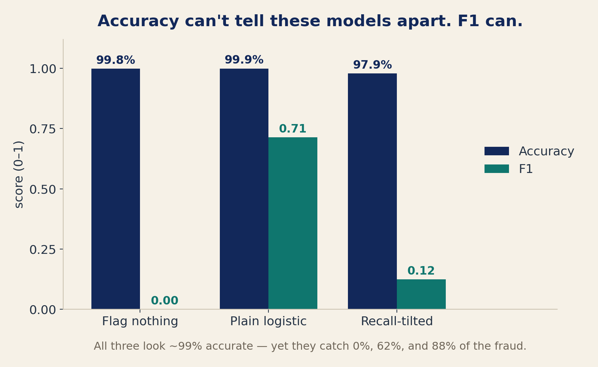

# A Fraud Model Can Be 99.9% Accurate and Catch Zero Fraud

*Precision, recall, and the one number that stops a model from faking it — and why each of them had to be invented.*

Here's a number that should bother you.

On the public dataset nearly every credit-card-fraud paper is built on — **284,807 real transactions, 492 of them fraud** — a model that does *nothing*, that approves every single transaction, scores **99.83% accuracy.** It also catches **zero** of the 492 frauds.

That's not a thought experiment. It's the standard benchmark (the ULB dataset behind [Dal Pozzolo et al.](https://re.public.polimi.it/bitstream/11311/1044896/1/08038008.pdf)), and it's the trap this piece is about: when the thing you care about is rare, **accuracy stops measuring skill and starts measuring the base rate.** You can score near-100% just by predicting "normal" forever.

A quick note on why I'm using fraud. The data is public and the stakes are obvious — but every question we're about to ask is the *same* question a radiologist asks of a tumor detector, a manufacturer asks of a defect scanner, a hospital asks of a readmission model. The domain changes; the evaluation questions don't. I'll point out the clinical mirror as we go, because that's the real lesson: these ideas are portable. A principal AI scientist who read the first piece in this series said it best — *one aggregate number can hide exactly which cases are being missed.* In a paper that's an oversight. In a clinic it's the patients who slip through.

To see past accuracy you need three ideas — the confusion matrix, precision, and recall — and then one number that forces them to behave. Let's build them, and I'll run a real model on the real data as we go.

## The confusion matrix — the map everything is read from

At a chosen cutoff, every classifier sorts each case into one of four boxes: **True Positive** (flagged, and really fraud — *caught*), **False Positive** (flagged, but legitimate — *false alarm*), **False Negative** (approved, but fraud — *missed*), and **True Negative** (approved, and legitimate — *correctly cleared*).

That 2×2 is the **confusion matrix**, and it's worth learning once, because almost every metric — precision, recall, specificity, F1, even the ROC curve we'll meet next time — is just this table read from a different angle. I trained a plain logistic-regression model on 70% of the data and tested it on the rest:

Ninety-one caught, sixteen false alarms, fifty-seven missed, 85,279 correctly cleared. Accuracy: **99.91%** — because that giant TN dwarfs everything, while the story that matters hides in the other three cells.

## The metrics no one invented — they were forced into existence

Here's the shift that makes these numbers stick. **Every evaluation metric exists because someone had to answer a practical question.**

Fraud investigators asked one: *"When my phone rings with an alert, how often is it really fraud?"* Ask that question precisely enough and you've defined **precision** — of everything the model flagged, the fraction that was truly fraud. A radiologist asks the identical question of a scan: when the model marks a tumor, how often is there really one?

Banks asked a different question: *"Of all the fraud that actually happened, how much are we missing?"* That question is **recall** — of everything that truly was fraud, the fraction the model caught. The oncologist's version is the one that keeps them up at night: of all the tumors that were really there, how many did we find?

Now the metrics don't feel invented. They feel *inevitable* — the exact shape of a question someone was already forced to answer. (One naming note that pays off next time: recall, sensitivity, and true positive rate are the same quantity. When we build the ROC curve for AUROC, that's where we start.)

Run our models through them. The do-nothing model: recall **0** — caught none. The real plain model: recall **0.615** — it catches 91 of 148 frauds and misses 57, at precision **0.85**. So it is **99.91% accurate and still misses more than a third of the fraud.** The headline barely moved above the do-nothing baseline; the number a bank actually loses money on is mediocre.

## Two questions, pulling in opposite directions

Now push the model to catch more fraud — weight the rare class harder. Recall jumps to **0.878**; it catches 130 of 148. But precision **collapses to 0.067**: it raises **1,807 false alarms** to find those 130 frauds. The investigators quit by Friday.

So we have two competing goals. Make your analysts happier — fewer false alarms — and you catch less fraud. Catch more fraud and you overwhelm your analysts. Precision and recall each measure one side of that tension, and **neither can declare a winner by itself:**

- **Plain model** — precision 0.85, recall 0.615. Safe-looking; misses fraud.
- **Recall-tilted model** — recall 0.878, precision 0.067. Catches most fraud; drowns in false alarms.

Report either one's *accuracy* and it looks fine (99.91% and 97.86%). What we need is a single number that refuses to reward a model unless it does reasonably well on *both*.

## Accuracy is blind. F1 is not.

Line up all three models on the same benchmark:

By accuracy they're nearly indistinguishable — you'd actually rank the model that catches **zero** fraud *above* the one that catches 88%. Now look at F1: **0.00, 0.714, 0.125.** The order finally makes sense — catching nothing is worst, the plain model is the best of a flawed bunch, and the aggressive model's false-alarm flood is penalized. Accuracy couldn't see any of it.

## F1: the weakest link

That number is the **F1 score** — the *harmonic* mean of precision and recall:

$$F_1 = \frac{2 \times \text{precision} \times \text{recall}}{\text{precision} + \text{recall}}$$

Why the harmonic mean and not a plain average? Because **an ordinary average is forgiving — one excellent score can rescue one terrible score.** The harmonic mean isn't so generous. It behaves like the weakest link in a chain: no matter how strong everything else is, the chain breaks where it's weakest.

Watch it break. Precision 1.0 and recall 0.5 average to a comfortable 0.75 — but F1 is **0.67**, pulled toward the weaker link. Push it further — precision 1.0, recall 0.01 — and the average still reads a respectable 0.5, while F1 reads **0.02**. The chain is only as strong as its weakest link, and F1 knows it.

And the real data handed us a subtlety for free: the recall-tilted model catches *more* fraud (0.878 vs 0.615) yet has a *lower* F1 (0.125 vs 0.714). **"Catch more" isn't automatically better** — F1 won't reward recall that was bought with a flood of false positives.

## Watch it happen yourself

Reading about a collapse isn't the same as seeing one. So I built a tiny simulator — two knobs, *prevalence* and *separation* — that generates labeled scores and lets you watch any metric move. Hold the model's quality fixed and just make fraud rarer:

Accuracy and AUROC sit perfectly still while precision and F1 fall off a cliff. Same model — only the base rate changed. Relabel "fraud" as disease, defect, or churn and nothing changes but the caption. *(I'll open-source the simulator alongside a later piece in the series, so you can run this yourself.)*

## What F1 still can't tell you

F1 is sharp, but narrow. It judges **one threshold** — move the cutoff and it shifts, and it can't tell you whether another operating point is better *(next time's job)*. It **ignores the probabilities**, so it can't say whether "97% sure" means anything *(that's calibration, soon)*. And it **shifts with prevalence**, so an F1 from a 0.17%-fraud setting won't transfer to a 2%-fraud one. Always report precision and recall beside it.

## One last trap: even a good F1 can lie

Before you trust anyone's F1 — including your own — know that a [2025 audit of fraud-detection methods](https://arxiv.org/html/2506.02703v1) found many reported F1 scores are **inflated by data leakage**: test-set information bleeding into training, or improper time-based splits. The number was real; the *setup* that produced it wasn't.

I've done this to myself. I once added a feature that turned out to be the diagnosis in disguise — and accuracy jumped about five points I hadn't earned. The metric was computed correctly; my pipeline was quietly leaking the answer.

Question the pipeline, not just the number — because a metric is only as honest as the process behind it.

## The next question

F1 grades a decision *after* the model has already committed to "yes" or "no." But what if we don't want the decision yet?

What if we first want the model to **rank** every case — every patient from most concerning to least, every transaction from most suspicious to safest — and only *then* decide where to draw the line? That is a completely different question, and it demands a completely different way of thinking about evaluation. Precision and recall can't answer it, because they only exist *after* the line is drawn.

This series isn't really about F1, or the metric that comes next. It's about learning to ask a model the right question — and to notice that most arguments about "which model is better" are really arguments about *which question you're asking.* Next time, we take this exact confusion matrix, slide the threshold across it from strict to loose, and watch the curve that measures pure ranking appear.

---

**Sources & further reading**
- ULB credit-card fraud dataset ([Kaggle](https://www.kaggle.com/datasets/mlg-ulb/creditcardfraud)) and Dal Pozzolo et al., [2015](https://boracchi.faculty.polimi.it/docs/2015_04_Credit_Card_Fraud_Detection_DalPozzolo_Boracchi_Caelen_Alippi_Bontempi.pdf) / [2018 (IEEE TNNLS)](https://re.public.polimi.it/bitstream/11311/1044896/1/08038008.pdf)
- Why precision-recall beats ROC under imbalance: [Saito & Rehmsmeier, 2015 (PLOS ONE)](https://journals.plos.org/plosone/article?id=10.1371/journal.pone.0118432); Davis & Goadrich, 2006 (ICML)
- [Reproducible ML for Credit Card Fraud Detection — practical handbook (ULB)](https://fraud-detection-handbook.github.io/fraud-detection-handbook/)
- [Data Leakage and Deceptive Performance in fraud detection (arXiv, 2025)](https://arxiv.org/html/2506.02703v1)

*By Nadia Sheikh · **Beyond Accuracy** — Question assumptions. Build intuition.*
