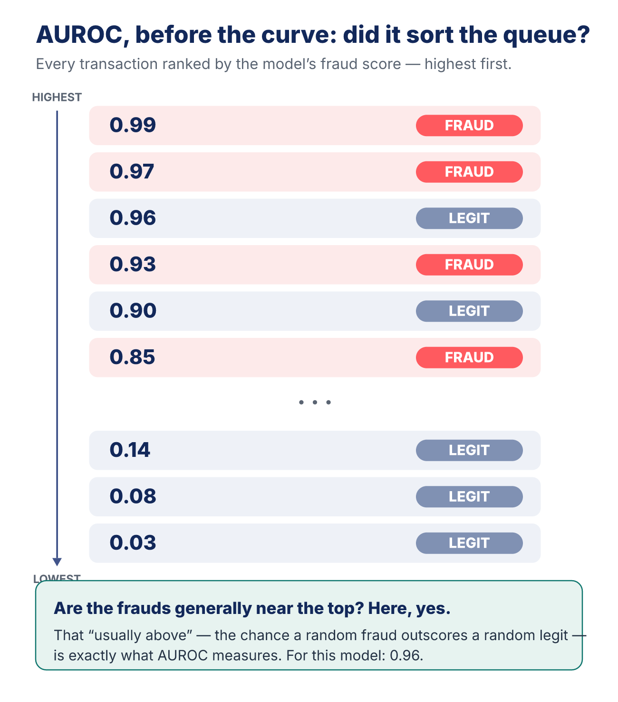
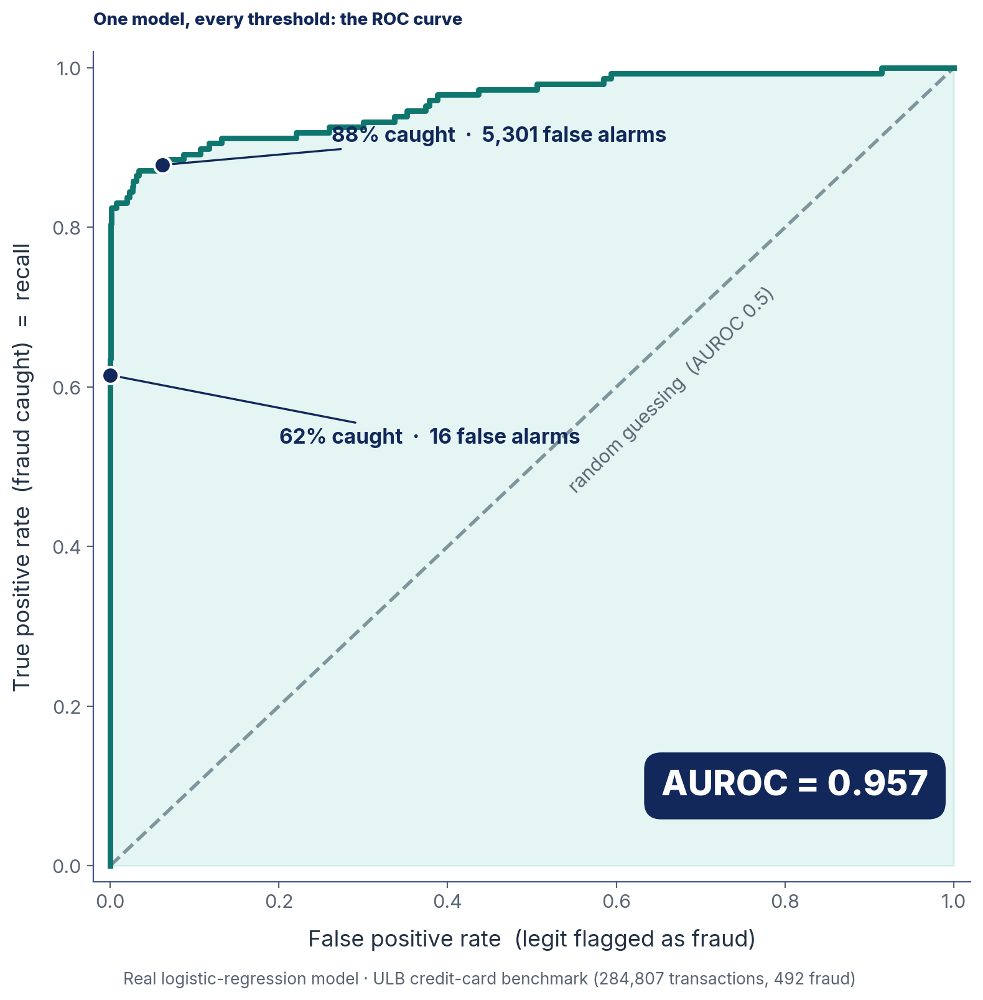
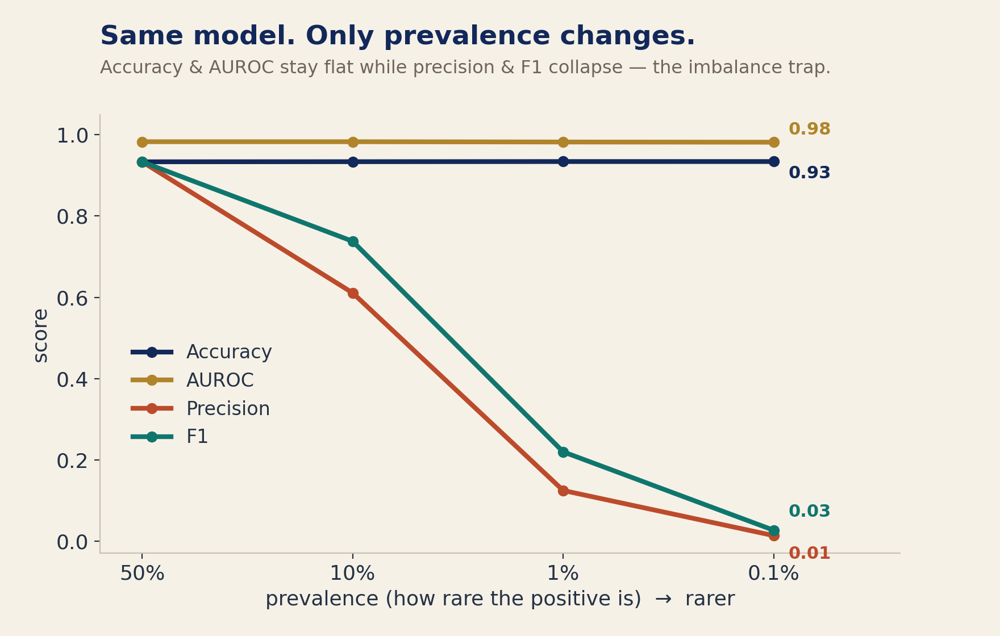

# A Model With 0.96 AUROC Can Still Bury You in False Alarms

*What the ROC curve actually is, why AUROC measures ranking instead of decisions — and the trap it hides when the thing you care about is rare.*

Last time, we left on a cliffhanger. F1, precision, recall — every one of them grades a decision the model has *already made*: yes or no, fraud or not, at one fixed cutoff. But there's an earlier, deeper question they can't touch.

Before a model decides, it *ranks.* It gives every transaction a score — every patient, every case — from most suspicious to least. The decision only happens later, when you draw a line and say "everything above this is a yes." So here's the question F1 can't answer: **forget the line for a second — is the model even any good at putting the fraud near the top?**

That question has its own metric, and it's the one with the intimidating name: **AUROC**, the area under the ROC curve. It sounds like jargon. It's actually one of the most intuitive ideas in evaluation — once you see what it's really measuring. Let's build it, on the same real fraud model from last time.

And here's where it's going: that model will earn a near-perfect **AUROC of 0.96** — and I'll *still* show you how it can drop **5,301 false alarms** on your fraud team in a single morning. Both are true at once. That gap is the whole story.

*New here? Start with [how a fraud model can be 99.9% accurate and catch zero fraud](https://medium.com/@nadiasheikh18/a-fraud-detection-model-can-be-99-9-accurate-and-catch-zero-fraud-5b9be7ab61e5) — this piece leans on the confusion matrix, precision, and recall that one builds.*

## The core idea: ranking, not deciding

Here's AUROC in one sentence, no math:

> **AUROC is the probability that the model scores a real fraud higher than a random legitimate transaction.**

Picture it. Reach into the data and pull out one real fraud and one real legit transaction, at random. Ask: did the model give the fraud the higher score? Now do that for *every* possible fraud–legit pair and count how often it got the order right. That fraction is the AUROC.

The medical mirror is exactly the same move. Pull one patient with Alzheimer's and one healthy patient; does the model score the sick one higher? Do it across every pair. A radiologist's model that reliably ranks the tumor above the clear scan has a high AUROC — *regardless of where anyone later sets the threshold.*

You can see the whole idea without any math. Line up every transaction by the score the model gave it, highest at the top:

Ask one question: are the frauds generally near the top? If they are, the model ranks well — and that is *all* AUROC is. You've even met its ingredients already: in the F1 piece we defined the true positive rate (recall) and the false positive rate, and AUROC is built entirely from those two. Here's the one sentence that clears up most of the confusion around it: **a model can have a fantastic AUROC even if nobody ever settles on a single threshold — because AUROC judges the *ordering* of the scores, not the final decisions.**

Notice what we just did: we compared scores, but we never chose a cutoff. **Ranking and thresholding are two different problems**, and AUROC is the one that lives entirely in ranking-land. That's why it can judge a model *before* you've committed to any decision.

## The ROC curve: one model, every threshold at once

So where does the curve come from? This is the part that pays off the promise I made last time — we take the *exact same confusion matrix* and slide the threshold across it.

This is where we reuse what we already built. The **true positive rate** — of the real fraud, the fraction you caught — is the same quantity we called recall and sensitivity last time. Its partner is the **false positive rate** — of the legitimate charges, the fraction you wrongly flagged. We defined *both* of these in the previous article, so we're not starting cold.

Those two numbers are the axes of the curve: the **false positive rate runs along the x-axis** (wrong alarms, left to right) and the **true positive rate up the y-axis** (fraud caught, bottom to top). Every threshold you could pick lands one dot in that space — a strict cutoff sits low and left (few catches, few alarms), a loose one sits high and right (more catches, more alarms). Sweep the threshold from strict to loose and the dots trace a curve. That's the **ROC curve** — and the acronym is worth unpacking. *ROC* stands for **Receiver Operating Characteristic**, a name borrowed from WWII radar: operators had to separate real enemy blips from random noise at every sensitivity setting of the receiver. That's *our* problem exactly — signal versus noise, across every possible cutoff.

So why the *area* under it? Because the area is the cleanest single-number summary of how far the whole curve bows toward the perfect corner. A flawless model shoots straight to the top-left — all the fraud, no false alarms — and fills the box: area **1.0**. A useless model hugs the diagonal: area **0.5**. **AUROC** is literally the **A**rea **U**nder the **ROC** curve — and it hides a small piece of magic: that area works out to be *exactly* the ranking probability from the queue above, the chance a random fraud outscores a random legit. Same number, two ways to see it.

Here's the real one, from the plain logistic-regression model we trained last time — same 284,807 transactions, same 492 frauds:

**AUROC = 0.957.** In plain terms: pick a random fraud and a random legit charge, and there's about a **96% chance the model scores the fraud higher.** Put the two ends side by side to feel the scale. An AUROC of **0.5** is a coin flip — a fraud is only 50% likely to outscore a random legit, which is no skill at all. Our **0.96** means the fraud wins that matchup 96 times out of 100. By the usual rule of thumb — 0.5 is guessing, 0.7 is decent, 0.85 is very good, 0.95 is excellent — this is a genuinely strong model. And it is, *at ranking.*

## The curve tells you what one number hides

Look at the two dots I marked, because this is where the ROC curve earns its keep. They're the *same model* — I only moved the threshold.

At a strict cutoff, the model catches **62% of the fraud with just 16 false alarms.** Loosen it and you can reach **88% caught — but now at 5,301 false alarms.** Same model, same scores; only the line moved.

And the shape between them is the real lesson. Going from 62% to 80% caught costs you almost nothing — 16 false alarms climb to about 77. But going from 80% to 88% costs you *5,301*. That cliff — cheap fraud-catching that suddenly turns ruinously expensive — is what the curve's bend is showing you. **That decision, where to stand on the trade-off, is the whole game.** And AUROC, the single number, quietly averages right over it.

Stay inside the fraud story to feel what this means. Picture the model sorting every transaction into one long queue, most-suspicious at the top — the very queue we started with. AUROC tells you how *well* it sorted that queue. It says nothing about where your fraud team should stop reading down the list; that depends on how many alerts they can realistically investigate in a day. Sorting the queue and deciding how far down to read are two different jobs, and AUROC only does the first. AUROC rates the road; you still have to pick the exit.

## The trap: a beautiful AUROC that hides a false-alarm flood

Now the part that should bother you — because a 0.957 is exactly the kind of number that ends up in a slide deck with no asterisk.

AUROC has a blind spot, and it's the same one accuracy had: **rare events.** Because AUROC is built from *rates* — the false positive *rate* — it barely moves when your positives are scarce. Remember the simulator from last time, where we held the model fixed and just made fraud rarer:

Accuracy and AUROC sit perfectly still while precision and F1 fall off a cliff. AUROC won't even flinch as your positives vanish into the crowd — which is precisely why it can look excellent while the model is, in practice, unusable. Our 6.2% false positive rate at 88% recall *sounds* tiny — until you translate the rate into people.

Picture it. You arrive Monday morning to investigate fraud, and your dashboard has **5,301 alerts** waiting. The overwhelming majority are ordinary customers who did nothing wrong. The model behind that dashboard is still, by AUROC, "excellent." Your analysts are burned out by lunch. That is what a 6.2% false positive rate *feels* like on 85,000 real transactions — the rate is small; the pile is enormous.

There's an honest companion number that doesn't let you get away with this: the **precision-recall curve** and its area (PR-AUC), which on this same model is a far more sobering **0.71**. Under heavy imbalance, PR-AUC tells you what AUROC politely won't ([Saito & Rehmsmeier, 2015](https://journals.plos.org/plosone/article?id=10.1371/journal.pone.0118432)). The rule: **when the positive class is rare, report AUROC *and* PR-AUC, and never quote a false positive rate without translating it into a raw count.**

## The next question

We've now asked three of the four big questions you can ask a model. Can it be *right*? (accuracy — and why it lies.) Does it *balance* catching and crying wolf? (precision, recall, F1.) Can it *rank*? (AUROC.)

But every one of those has taken the model's scores at face value. When this model says a transaction is "0.97 fraud," we've used that 0.97 only to *rank* and to *threshold* — never once have we asked the obvious thing: **is it actually true?** Of all the times a model says "97% sure," does fraud really happen 97% of the time — or is the model just a confident liar whose numbers happen to sort in the right order?

A model can rank beautifully and still be badly wrong about its own confidence. That gap between what a probability *says* and what actually *happens* has a name — **calibration** — and it's where trust in a model is won or lost. That's next.

Because this series was never really about F1, or AUROC, or the metric after it. It's about noticing that most arguments over "which model is better" are really arguments about *which question you're asking* — and making sure it's the right one.

---

**Sources & further reading**
- ULB credit-card fraud dataset ([Kaggle](https://www.kaggle.com/datasets/mlg-ulb/creditcardfraud)); Dal Pozzolo et al., [2018 (IEEE TNNLS)](https://re.public.polimi.it/bitstream/11311/1044896/1/08038008.pdf)
- Why precision-recall beats ROC under imbalance: [Saito & Rehmsmeier, 2015 (PLOS ONE)](https://journals.plos.org/plosone/article?id=10.1371/journal.pone.0118432); Davis & Goadrich, 2006 (ICML)
- ROC/AUROC foundations: [Fawcett, 2006 — An introduction to ROC analysis](https://www.sciencedirect.com/science/article/abs/pii/S016786550500303X)
- The math behind it — AUROC = the probability a random positive outranks a random negative, and why that equals the area (the Wilcoxon/Mann–Whitney equivalence): [Hanley & McNeil, 1982 — *The Meaning and Use of the Area Under a ROC Curve* (Radiology)](https://pubs.rsna.org/doi/abs/10.1148/radiology.143.1.7063747)

*By Nadia Sheikh · **Beyond Accuracy** — Question assumptions. Build intuition.*
