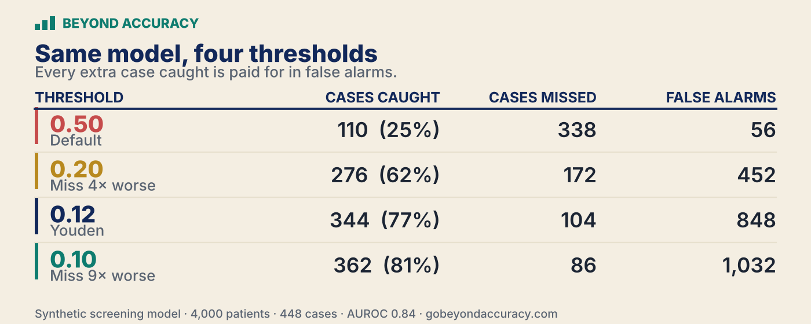

# Your AI Model Predicts Risk. But Who Decides When to Act?

*How a decision threshold turns a reliable probability into an action — and why that choice is yours, not the model's.*

*Also on Medium → [the essay version of this chapter](https://medium.com/@nadiasheikh18/your-ai-model-predicts-risk-but-who-decides-when-to-act-6b07eafab83f).*

Every chapter so far has graded the *model*. Can it make the call (F1)? Can it rank cases by risk (AUROC)? Can you believe its confidence (calibration)? Suppose a model finally clears all three. It predicts well, it ranks well, and when it says "30%" about 30% of those cases really are positive. Here's the question none of those metrics can answer: **you now hold a trustworthy probability — what do you *do* with it?**

That step is its own skill, and it's the one most pipelines skip. The model hands you a number between 0 and 1; turning that into a yes/no action means drawing a line. Where you draw it is not the model's call. It's yours — and it decides everything downstream.

The handbook's running example is credit-card fraud, but for thresholds the clearest lab is a case where we know the ground truth *exactly*: a **synthetic screening model**, where we generate the population ourselves. Relabel "sick" as "fraud" and "refer" as "investigate" and every move below holds — the cost of a missed cancer is just easier to feel in the gut than the cost of a missed chargeback. The clinical mirror is called out, but the machinery is domain-neutral.

*New here? These earlier pieces build the vocabulary this one leans on: [AUROC and ranking](https://medium.com/towards-artificial-intelligence/a-model-with-0-96-auroc-can-still-bury-you-in-false-alarms-028d05517553), and [calibration](https://medium.com/towards-artificial-intelligence/does-your-ai-know-when-it-might-be-wrong-1c32f1e1fffc) — can you trust the number itself.*

## A model that does everything right, and a decision that goes wrong

Start with a strong model. On 4,000 synthetic patients — about **11% truly sick** (448 cases) — it ranks the sick above the healthy reliably (**AUROC 0.84**), and its probabilities are honest (decile calibration error ≈ 1%). By every test in this handbook so far, it passes.

Now make the decision the default way. The model gives each patient a risk; the obvious thing — the thing nearly every tutorial does without comment — is to act on everyone above **0.5**, a predicted risk of 50%. Do that, and watch what happens:


It caught **a quarter of the disease.** Of 448 sick patients it flagged 110 and **missed 338**, while raising only 56 false alarms. The model didn't fail — its ranking is intact, its probabilities are honest. What failed was the **decision rule**: a cutoff picked without weighing the consequences turned good estimates into a bad outcome. And nobody chose 0.5 on purpose; it was just the default.

That is the whole subject of this chapter. Call it the fourth verb: **Decide.**

> **A probability is a statement about the world. A threshold is a statement about what you value.**

The model supplies the first. Only you can supply the second. Deciding *is* setting that threshold — the cutoff above which you act — and the moment you pick it, you've made a value judgment about which mistake you'd rather make.

## 0.5 is a decision you didn't know you were making

The default feels neutral. It isn't. A screening model makes two kinds of mistake: a **missed case** (a sick patient waved through — a false negative) and a **false alarm** (a healthy patient flagged for nothing — a false positive). Acting only above 50% quietly declares that **a missed case and a false alarm cost exactly the same** — that you'd trade one missed patient for one false alarm and feel even.

In almost no real setting is that true. Missing an early cancer is not the same as calling one patient back for a scan that turns out clear. A fraud team feels the identical asymmetry: a missed fraud is a loss booked; a false alarm is five minutes of an analyst's time. And when the positive is **rare**, the default is especially punishing. Low prevalence doesn't *guarantee* this, but when the features give only moderate discrimination, even a well-calibrated model lands many genuinely sick patients below 50% — it's seldom more than half-sure about anyone. A rule that acts only above 50% then flags almost none of them.

That doesn't contradict the ranking. AUROC is about *order* — sick scoring higher than healthy — not about where the scores land on the 0-to-1 scale. This model ranks 338 of its 448 sick patients above the healthy and yet still below 0.5. Ranked well, acted on badly.

The first move, then, is simply to **make the choice on purpose.**

## The statistical answer — and why it isn't enough

The classic way to pick a cutoff from the data alone is **Youden's index**. It uses two numbers: **sensitivity** (the share of truly sick patients caught) and **specificity** (the share of truly healthy patients correctly left alone). Youden picks the threshold that maximizes

```
J = sensitivity + specificity − 1
```

— equivalently, the threshold that maximizes their sum. On this model it lands at **0.12**, and the picture flips: sensitivity jumps from 25% to **77%**, specificity is **76%**, and the model now catches 344 of 448 cases instead of 110 — but false alarms climb from 56 to 848.


But notice what Youden quietly assumes: that one point of sensitivity is worth exactly one point of specificity. It's a *statistical* balance — blind to how common the disease is and to what either error actually costs. A fine reference point when you truly have no cost information; the wrong anchor the moment you do. Which is almost always.

## The honest driver: the cost of the two errors

Here's the idea that reorganizes everything. The threshold should be set by a single question: **how many times worse is a missed case than a false alarm?**

Call that number the **cost ratio**, *R*. ("Cost" means real-world harm: a missed case can mean disease caught too late; a false alarm, an unnecessary and sometimes invasive follow-up.) For a *calibrated* model, when the only things on the scale are those two error costs, the expected-cost-minimizing threshold is a single line of arithmetic:

```
act if predicted risk ≥ p_t ,   where   p_t = 1 / (1 + R)
```

*p_t* is the probability threshold (*p* for probability, *t* for threshold). Read it slowly — it's the whole game:

- Errors **equal**, *R = 1* → *p_t* = 1/(1+1) = **0.50**. That's exactly why the naive default catches so little.
- A miss **9× worse**, *R = 9* → *p_t* = 1/(1+9) = **0.10**. You act at just 10% risk, accepting more false alarms to avoid a miss.
- A false alarm **4× worse**, *R = 1/4* → *p_t* = 1/(1+0.25) = **0.80**. Now you act only when you're 80% sure.

One thing *R* is *not*: a promise about headcount. It sets the **relative cost** of the two errors, not the number of false alarms you'll trade for each extra case caught — that depends on the model and the prevalence. The nine is a statement of values, not a body count. (And the formula assumes the plain act / don't-act decision we're in; capacity limits, per-patient costs, or richer actions each need more than this one line.)

On this model, that one number moves everything:



Same model, same probabilities, same patients. The only thing that changed was an honest statement of what the mistakes cost — and *that statement*, not the algorithm, decided who got caught. The threshold is where the domain, not the machine learning, has to speak.

One thing the table hides: the **volume**. Dropping from 0.50 to 0.10 takes the model from flagging about 166 patients (4% of everyone screened) to 1,394 (35%) — roughly eight times the referrals. Every extra case caught is paid for, and not only in false alarms: it's paid for in a workload a real clinic, or a real fraud team, may simply not have the capacity to carry. Where the cost ratio meets a finite budget is a problem of its own — a thread for a later chapter.

## The question underneath all of it: does acting even help?

Suppose you've chosen a threshold. One question remains — the one that should be asked first and almost never is: **does using this model actually beat the obvious alternatives**, acting on everyone or acting on no one?

That's what **Decision Curve Analysis (DCA)** answers — a method from [Vickers & Elkin (2006)](https://journals.sagepub.com/doi/10.1177/0272989X06295361), not something invented here. It rests on a quietly brilliant reframing: the threshold you'd act at *is itself* a statement of how you weigh the two errors. A clinician who'd act at 10% is telling you a missed case is worth about nine false alarms — so weigh their harms in exactly that proportion. That gives one number, **net benefit**, at any threshold:

```
net benefit = (true positives / N) − (false positives / N) × p_t / (1 − p_t)
```

*N* is the total number of patients evaluated. True positives are the good the model does; false positives are penalized in exact proportion to that same trade-off. Compute it across every threshold a reasonable decision-maker might hold, and plot three lines: the model, **act on everyone**, and **act on no one**.


Across the thresholds a clinician might reasonably hold for a screening referral — roughly 5% to 30% — the model delivers at least as much estimated net benefit as either default. The trade-off is revealing: at very low thresholds, acting on everyone can make sense, because the priority is to miss as few cases as possible; but as the threshold rises, each unnecessary action weighs more, and eventually "everyone" produces *less* net benefit than "no one." "Act on no one" always scores exactly zero — a mathematical reference point, not a claim that missing every case is harmless.

*Estimated* is the word doing the work. These results describe the model's potential value **under the experiment's assumptions**; they don't prove patients would benefit in practice. Showing that takes external validation and, ultimately, a prospective study. But the decision curve earns its keep before any of that: if a model does no better than acting on everyone (or no one) at the thresholds people would really use, you've learned it offers no decision advantage *in its current form* — a signal to recalibrate, improve, or rethink the workflow — and you learned it before a single patient was affected.

## Which threshold, when

- **You genuinely don't know the costs yet** → reach for **Youden's index** as a *statistical* reference point, not a clinical default. Use it to explore trade-offs while you work with domain experts to set a real policy.
- **You know one error is worse** (almost always) → set the threshold from the **cost ratio**, `p_t = 1/(1+R)`. Make the relative cost explicit — "how much worse is a missed case than a false alarm?" — then read the actual trade-off at that threshold, not at 0.5.
- **Before you deploy anything** → run a **decision curve.** If the model does no better than the defaults at realistic thresholds, that's a signal to fix the model or the workflow, not just to nudge the cutoff.

## One assumption hiding underneath all of this

Every threshold here rests on one quiet assumption: that the probabilities are calibrated *in the population where the decision is actually made.* This model is calibrated at 11% prevalence. Move it to a hospital with a different case mix — or a different fraud rate — and that may no longer hold, and a threshold set on the old probabilities would be aimed at the wrong place. A decision rule is only as trustworthy as the probabilities underneath it.

So in practice the first move isn't to nudge the cutoff — it's to check whether the model is still calibrated where it now lives. A recalibration or prevalence correction may be enough; but if the relationship between features and outcome has changed, simple recalibration may not be, and the model needs deeper validation or redevelopment. That question — *will it work elsewhere?* — is where the journey goes next.

## The next question

Four questions in. Can it predict (F1)? Can it rank (AUROC)? Can you trust it (calibration)? And now: at what number do you act, and at what cost (Decide)? Each one has been about the model and the decision at hand, on the data in front of us.

But clearing all four is **not** a certificate of trustworthiness. A model can pass every test here and still fail — on a population it wasn't built for, on a subgroup the averages hid, or through clumsy deployment. The next question leaves the model's own numbers behind and asks whether any of this *travels*: **generalization.** That's where the map goes from here.

## Reproduce it

Every number in this chapter is computed, not asserted. The generating script is in this repo:

```bash
pip install -r requirements.txt
python code/build_decide_experiment.py
#  → generates 4,000 synthetic patients (fixed seed), prints the full
#    threshold table (0.50 / 0.20 / Youden 0.12 / 0.10), the cost-ratio
#    map, and the decision-curve summary; regenerates the threshold and
#    decision-curve figures from that data.
```

The data is synthetic and built from a fixed random seed, so one run rebuilds the exact population and the exact numbers above — no external dataset to download. It's the same idea as the handbook's `simulator/` (positives and negatives drawn from two Gaussians, prevalence and separation as the knobs); here the scores are turned into a *calibrated* posterior so the thresholds mean what they say.

---

**Sources & further reading**
- The sensitivity-plus-specificity operating point: [Youden, 1950 — *Index for Rating Diagnostic Tests* (Cancer)](https://acsjournals.onlinelibrary.wiley.com/doi/10.1002/1097-0142(1950)3:1%3C32::AID-CNCR2820030106%3E3.0.CO;2-3)
- Net benefit vs. treat-all / treat-none: [Vickers & Elkin, 2006 — *Decision Curve Analysis* (Medical Decision Making)](https://journals.sagepub.com/doi/10.1177/0272989X06295361)
- The plain-language DCA primer: [Vickers, van Calster & Steyerberg, 2019 (Diagnostic and Prognostic Research)](https://link.springer.com/article/10.1186/s41512-019-0064-7)
- Discrimination, calibration, and clinical usefulness together: [Steyerberg et al., 2010 — *Assessing the Performance of Prediction Models* (Epidemiology)](https://pubmed.ncbi.nlm.nih.gov/20010215/)

*By Nadia Sheikh · **Beyond Accuracy** — Question assumptions. Build intuition.*
